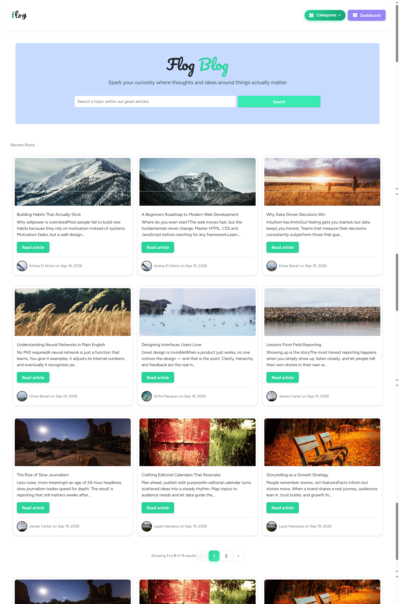
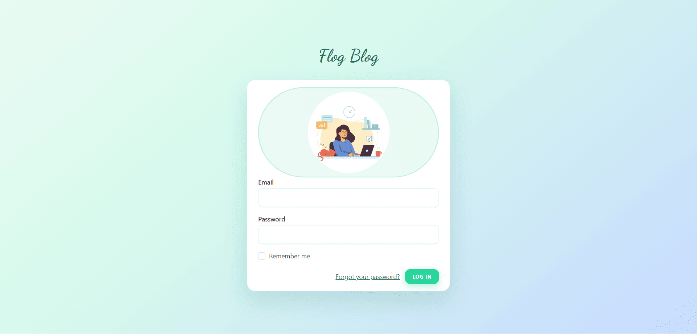
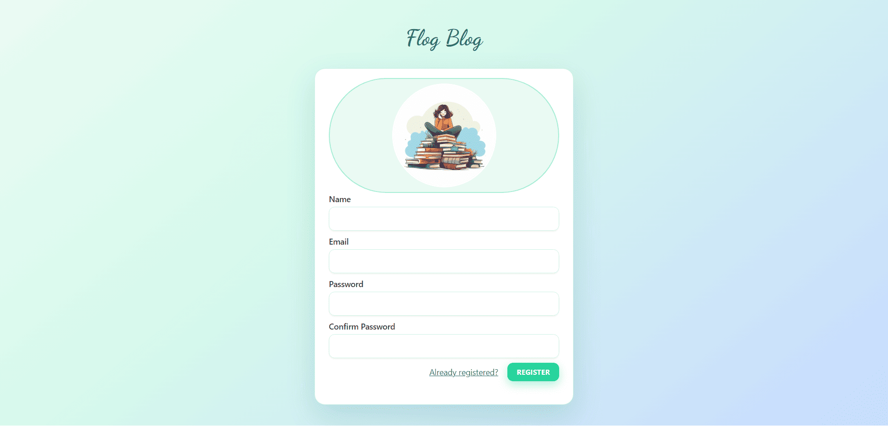
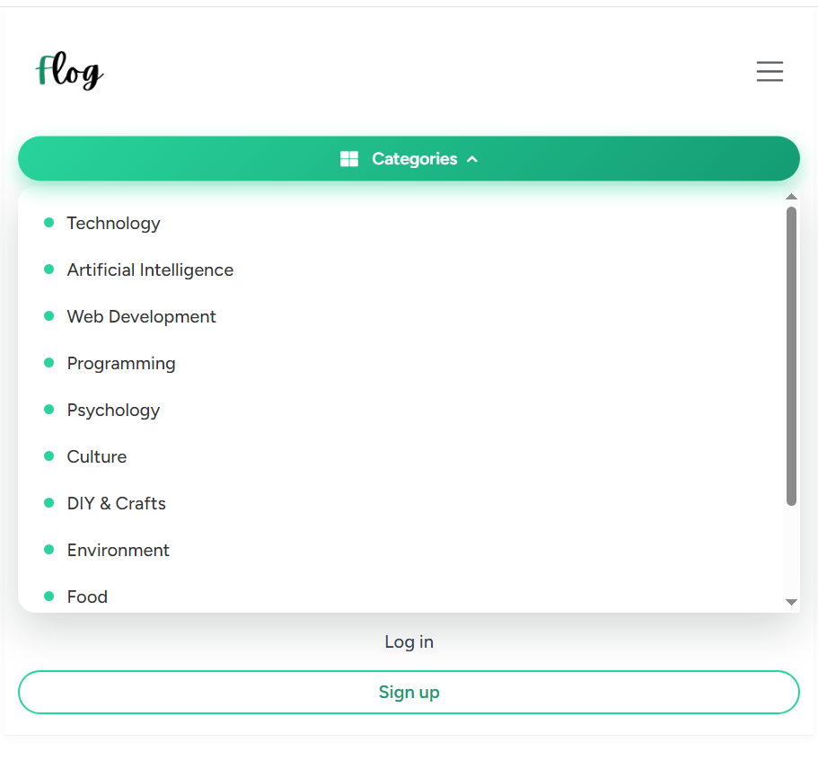
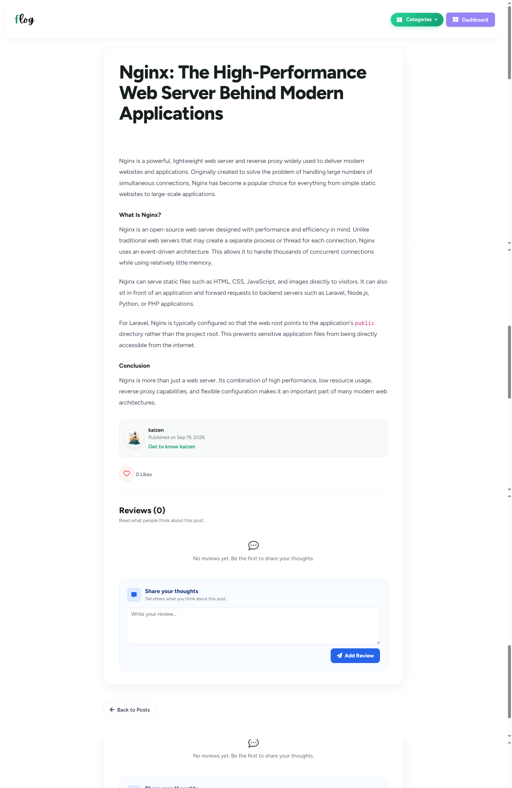
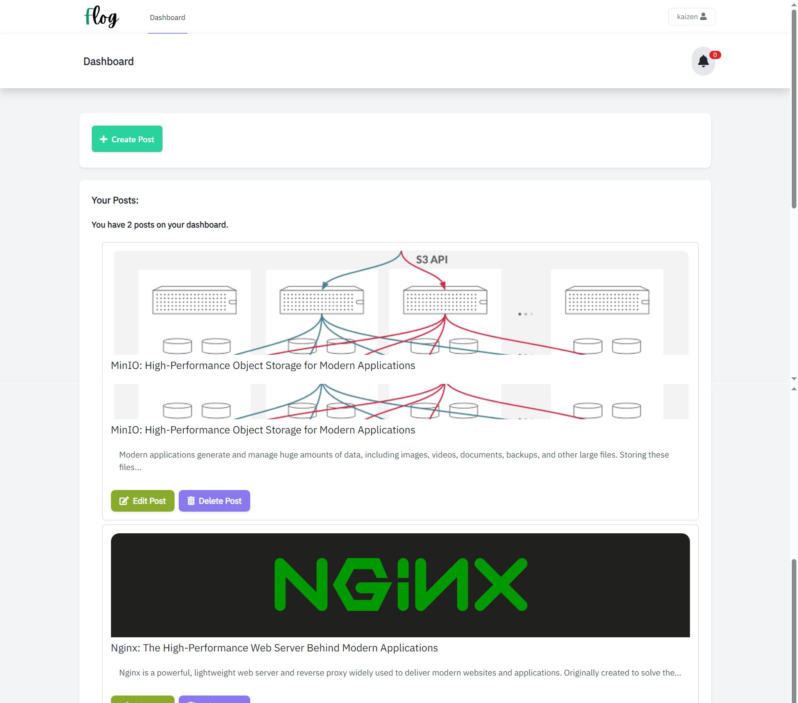
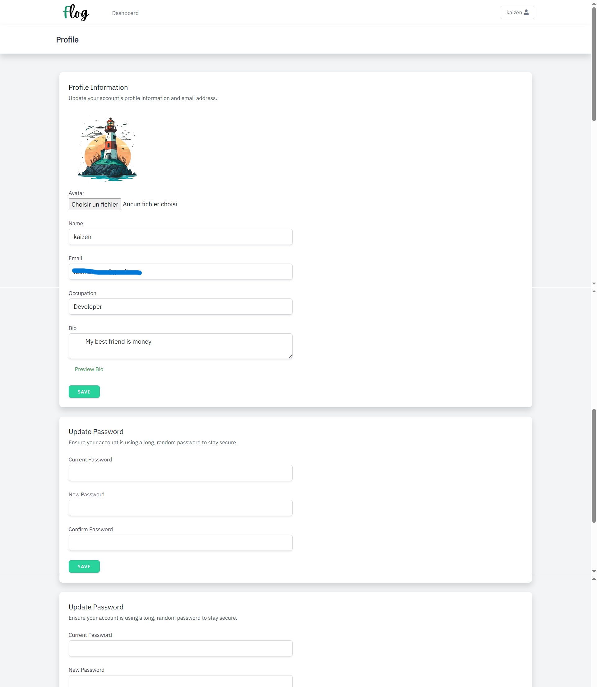

# Laravel Blog Application ( **_Flog Blog_** )

## 🚀 Introduction
This is a feature-rich **Laravel-powered Blog Application** with modern functionalities, built to provide a seamless user experience. It includes a full authentication system, a rich text editor for content creation, database notifications, and interactive user engagement features.
## ✨ Features
### 🔐 **Authentication & User Management**
- Full user authentication implemented using **Laravel Breeze**.
- Email verification enabled for enhanced security.
- Users can freely update their profile information.
### 📝 **Content Creation & Management**
- **Rich Text Editor**: Integrated **TinyMCE** for a flexible and powerful post-editing experience.
- **Categorization**: Posts are organized into categories to improve content discovery.
### 🔔 **User Notifications**
- **Database notifications** keep users informed about interactions with their posts.
- Notifications can be marked as **read** for better organization.
### ❤️ **User Engagement**
- Users can **like posts**, **leave reviews**, and **reply to existing reviews**.
- Interactive features enhance the blog community experience.
### 🏠 **User Dashboard**
- Users have a dedicated **dashboard** to:
  - Manage their posts.
  - View and interact with notifications.
  - Update profile settings.
---
## ⚙️ Installation & Setup
### **1️⃣ Clone the Repository**
```sh
git clone https://github.com/Fcharki/flog_laravel_blog.git
cd flog_laravel_blog
```
### **2️⃣ Install Dependencies**
```sh
composer install
npm install
```
### **3️⃣ Environment Setup**
add an environment file(.env) and generate an application key:
```sh
php artisan key:generate
```
Configure your **database credentials** in `.env`:
```sh
DB_CONNECTION=mysql
DB_HOST=127.0.0.1
DB_PORT=3306
DB_DATABASE=your_database_name
DB_USERNAME=your_database_user
DB_PASSWORD=your_database_password
```
### **4️⃣ Run Database Migrations**
```sh
php artisan migrate
```

### **5️⃣ Run Database Seeders**
```sh
php artisan db:seed
```

This seeds the database with:

- **20 categories** — Technology, Artificial Intelligence, Web Development, and more.
- **6 demo users** — each with a bio, occupation, avatar, and verified email:
  | Name | Email | Occupation |
  |---|---|---|
  | Amina El Idrissi | `amina.elidrissi@example.com` | Software Engineer |
  | Omar Benali | `omar.benali@example.com` | Data Scientist |
  | Sofia Marquez | `sofia.marquez@example.com` | Product Designer |
  | James Carter | `james.carter@example.com` | Journalist & Blogger |
  | Layla Hasnaoui | `layla.hasnaoui@example.com` | Content Strategist |
  | Noah Williams | `noah.williams@example.com` | Photographer |

  > All demo users log in with the password: `password`
- **12 demo posts** — two per demo user, each assigned to a category.

> Both demo users and demo posts use **real photos** served from [Lorem Picsum](https://picsum.photos) (`https://picsum.photos/seed/...`), so no local placeholder files are generated. Local uploads made through the app keep using `storage/app/public`.

> The seeders are **idempotent** — re-running `php artisan db:seed` only adds what's missing, so no duplicates are created.

### **6️⃣ Serve the Application**
```sh
php artisan serve
```

### **7️⃣ Build Frontend Assets**
```sh
npm install && npm run dev
```
Now, visit **http://127.0.0.1:8000** in your browser! 🚀
---
## 📸 Screenshots

| Page | Preview |
|---|---|
| Home |  |
| Login |  |
| Register |  |
| Category |  |
| Post details |  |
| Dashboard |  |
| Profile |  |
---
## 📜 License
This project is open-source and licensed under the [MIT License](LICENSE).  
You are free to use, modify, and distribute it as long as you include the original license.
---
## 📬 Contact
For any inquiries or support, reach out via:
- **Email**: fadma.charki101@gmail.com
- **GitHub**: [Fcharki](https://github.com/Fcharki/)
